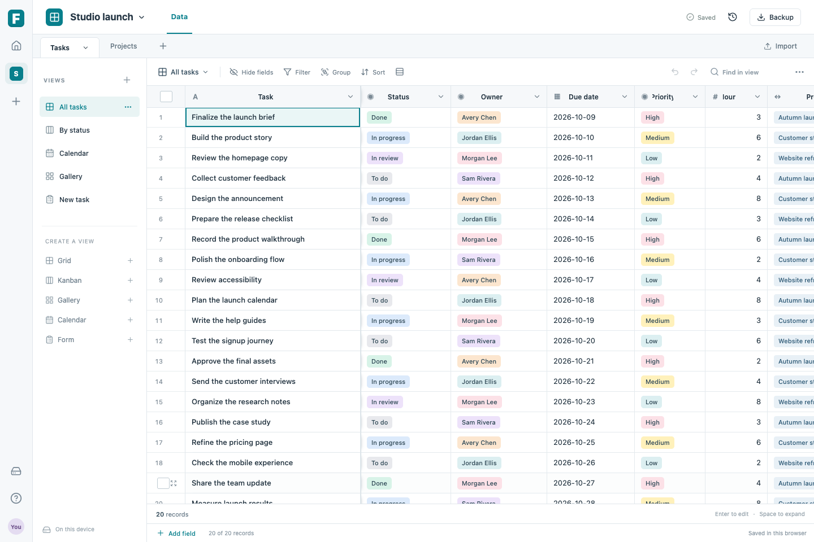

# Fairtable

**If you know how to use Airtable, you know how to use Fairtable.**

An independent, open-source relational spreadsheet for personal use and self-hosting. Familiar bases, tables, fields, linked records, and views, with a Rust calculation engine and a React interface. Your workspace lives in your browser or in a SQLite file on your own machine.

Fairtable is an early personal edition, not a complete Airtable replacement. It is not affiliated with or endorsed by Airtable. Original code is [MIT licensed](LICENSE); see [implementation provenance](docs/PROVENANCE.md).

**[Try Fairtable in your browser](https://fairtable.deleteddeleted.chatgpt.site)** · **[Download / self-host](https://github.com/harrisonoconnorhover/fairtable/releases)**



## What you can do

- Create and organize bases, tables, records, and saved views. Start with the clearly marked, editable sample base or create a blank one.
- Edit a virtualized grid with keyboard navigation, range selection, copy/paste, bulk clearing, row selection, record expansion, column resizing/reordering, and undo/redo.
- Filter, sort, search, group, hide fields, and change row height. Switch between grid, kanban, gallery, calendar, and personal form views. Move kanban cards between statuses or calendar records between dates.
- Use text, long text, number, USD currency, percent, checkbox, date, email, URL, single select, multiple select, linked record, formula, lookup, and rollup fields.
- Import a UTF-8 CSV into a new table with a preview and explicit column types. Export the current view as CSV or the complete workspace as JSON.
- Save automatically, restore one of the latest 30 previous saved workspaces, and move a JSON backup between browser and server editions.

Team accounts, permissions, live collaborative editing, public form collection, attachments, automation builders, integrations, and complete Airtable formula/API compatibility are outside this release. Forms add records to the current personal workspace. They are not externally shareable collection endpoints.

## Start with a native release

Download the archive for your operating system and architecture from [Releases](https://github.com/harrisonoconnorhover/fairtable/releases). Native releases contain one executable with the web interface and SQLite included; Rust, Node, and Docker are not needed to run it.

1. Extract the archive. On macOS/Linux, open a terminal in the extracted directory.
2. Run `./fairtable`.
3. Open **http://127.0.0.1:7777** in your browser. Leave the terminal running; press Ctrl+C to stop the server.

Archive names include the Rust platform identifier: `aarch64-apple-darwin` is Apple Silicon, `x86_64-apple-darwin` is Intel Mac, and `*-unknown-linux-gnu` is Linux. Use the release's published files and notes as the list of available, tested builds. Linux archives built on Ubuntu 24.04 target systems with glibc 2.39 or later; use Docker or build from source on older systems. macOS binaries are not signed or notarized. Windows native binaries are not packaged; the browser edition and Docker are the available paths there.

A neighboring `.sha256` file lets you check a downloaded archive: `shasum -a 256 -c FILE.tar.gz.sha256` on macOS or `sha256sum -c FILE.tar.gz.sha256` on Linux.

## Build and run from source

Install Rust through rustup, Node.js 24, pnpm 11.25.0, and a C compiler (Xcode Command Line Tools on macOS; `build-essential` on Debian/Ubuntu). The repository pins Rust 1.95.0 and the WebAssembly target. Install the matching WebAssembly binding tool once:

```sh
corepack enable
corepack prepare pnpm@11.25.0 --activate
cargo install wasm-bindgen-cli --version 0.2.108 --locked
rustup component add --toolchain 1.95.0 rust-docs
```

From the repository root:

```sh
./scripts/run-local.sh
```

This installs the locked frontend dependencies, builds the Rust WebAssembly module and interface, embeds them in a native release executable, and starts http://127.0.0.1:7777. Later runs rebuild from the current source using the existing caches. The first build needs network access to download dependencies; the resulting native application does not require a cloud account.

To build without starting:

```sh
pnpm install --frozen-lockfile
pnpm run build
node scripts/generate-notices.mjs
cargo build --release --locked -p fairtable-server
./target/release/fairtable-server
```

Build the frontend **before** the server to embed the latest interface. A server compiled without `dist/index.html` displays a development placeholder. `FAIRTABLE_ASSETS=/absolute/path/to/dist` can serve an existing build without embedding it again.

## Browser edition and your data

The browser edition uses the same interface and Rust WebAssembly engine, saving records in IndexedDB on the current device and browser profile. A static deployment needs only the contents of `dist/`, served over HTTPS (or HTTP on localhost), with WebAssembly served as `application/wasm`. The application is built for a site's root path. Opening `index.html` directly with `file://` is not supported.

To try a local browser-only build:

```sh
pnpm run build
pnpm run preview
```

Open http://127.0.0.1:5177. The interface identifies whether it is saving **in this browser** or **on your server**. When a Fairtable API is available on the same origin, the app uses server storage. Once a browser origin has been used with server storage, a missing server is an error, rather than a switch to a different local workspace.

Fairtable has no telemetry, external fonts, or record-upload service. In browser mode, records and imports are processed locally. A site host still receives ordinary requests for application files; in server mode, workspace data is sent to the Fairtable server you opened. The application does not encrypt database files or downloaded backups.

Browser data does not automatically follow you to another device, browser, profile, domain, or port. Clearing site data, removing the browser profile, private browsing, or browser storage eviction can remove it. Use **Backup → Download a complete backup** regularly. Restore that JSON file through **Backup and restore** in either edition. A complete JSON backup contains the current document, including bases, tables, fields, records, links, and views; historical snapshots and your temporary undo stack are not included.

CSV is a view export, not a complete backup: it contains matching records and visible fields, with displayed/calculated values. Formula-like text is escaped for spreadsheet safety. Import creates a new table and does not recreate formulas, links, or views from a CSV.

## Self-hosting and SQLite

The native server binds to `127.0.0.1:7777` by default. The personal edition has **one workspace and no login system**. For access from other machines, put it behind your own authenticated HTTPS reverse proxy; protect both the interface and every `/api/*` route. Setting an origin is a browser request check, not authentication.

| Variable | Purpose | Default |
| --- | --- | --- |
| `FAIRTABLE_DATA` | SQLite file path; parent directories are created | Platform-specific location below |
| `FAIRTABLE_HOST` | IP address to listen on | `127.0.0.1` |
| `FAIRTABLE_PORT` | HTTP port | `7777` |
| `FAIRTABLE_ORIGIN` | Exact external browser origin, including scheme and optional port | Local same-origin access only |
| `FAIRTABLE_ASSETS` | Directory containing a built `index.html` and its assets | Assets embedded in executable |

Default storage:

- macOS: `~/Library/Application Support/Fairtable/fairtable.sqlite3`
- Linux: `$XDG_DATA_HOME/fairtable/fairtable.sqlite3`, or `~/.local/share/fairtable/fairtable.sqlite3`

An explicit `XDG_DATA_HOME` also takes precedence on macOS. The server prints its actual database path at startup. Each successful save checks the expected revision inside a SQLite transaction; stale or invalid writes do not replace the saved workspace. Restore saves the current document to history before replacing it. Concurrent edits are detected, not merged: download an unsaved backup before reloading after a conflict.

For a remote HTTPS proxy, set `FAIRTABLE_ORIGIN=https://tables.example.com` and forward requests to the listener while preserving the public `Host` header. Keep the backend inaccessible from the public Internet. A reverse proxy's body limit must allow at least 33 MiB for the JSON request envelope. If the proxy is on the same machine, the default loopback listener is sufficient.

For a full database backup including history, stop Fairtable cleanly before copying its SQLite file. While running, SQLite can also have `-wal` and `-shm` companion files; copying only the main file during writes is not a reliable backup. Keep the database on a local persistent disk. Before upgrades, stop the process and keep a cold backup, then replace the executable and restart it with the same database path.

## Docker

Build locally, then publish the port only on your machine:

```sh
docker build -t fairtable:local .
docker volume create fairtable-data
docker run -d --name fairtable \
  -p 127.0.0.1:7777:7777 \
  -v fairtable-data:/data \
  fairtable:local
```

Open http://127.0.0.1:7777. The container runs as an unprivileged user and keeps its database in `/data/fairtable.sqlite3`. The named volume survives container replacement. Stop it with `docker stop fairtable`; start it again with `docker start fairtable`. Do not delete the volume unless you intend to delete its workspace and history.

For a proxy deployment, add `-e FAIRTABLE_ORIGIN=https://tables.example.com` and expose the container only to your authenticated proxy. Inside Docker the process listens on `0.0.0.0` so port forwarding works; the loopback port mapping above keeps the default host installation local. Rebuilding an image does not update an existing container: replace the container using the same volume after taking a backup. No prebuilt registry image is required.

## Working in a table

| Action | Shortcut or control |
| --- | --- |
| Move the selected cell | Arrow keys, Tab / Shift+Tab |
| Edit | Double-click, Enter, F2, or begin typing |
| Select a range | Drag across cells or Shift+arrows |
| Copy / cut / paste | Ctrl/⌘ C, X, V |
| Expand a record | Space or the row's expand control |
| Clear selected values | Delete / Backspace |
| Undo / redo | Ctrl/⌘ Z / Shift+Z while the grid is focused |
| Configure a field | Click its column name |
| Close an editor/dialog | Escape |

Paste accepts rectangular tab-separated blocks. Add enough records and fields first; a paste extending beyond the table is rejected. Invalid values reject the entire paste, and calculated fields are preserved. A single pasted value can fill a selected range. The first field supplies record names; linked records refer to stable record IDs.

Formula references use `{Field name}`, for example `IF({Status} = "Done", {Hours} * 100, 0)`. The engine supports arithmetic, comparisons, string concatenation, `IF`, `AND`, `OR`, `NOT`, `SUM`, `AVERAGE`, `MIN`, `MAX`, `COUNT`, `COUNTA`, `ROUND`, `ABS`, `CONCATENATE`, `UPPER`, `LOWER`, `LEN`, `TRIM`, `LEFT`, `RIGHT`, `YEAR`, `MONTH`, `DAY`, `TODAY`, `TRUE`, `FALSE`, and `BLANK`. Rollups also support `ARRAYJOIN`. This is a defined subset, not Airtable's entire formula language. Errors are shown in calculated cells; invalid formulas can be saved for editing.

Dates are `YYYY-MM-DD`; currency displays USD; percent stores/display values on a 0–100 scale (`25` means `25%`). Select options must exist before they can be pasted. Keyboard and range workflows work best with a desktop keyboard; mobile uses scrolling, record detail dialogs, and the collapsible view menu.

## Limits and recovery

The current document limit is 32 MiB, with at most 50 bases, 100 tables across the workspace, 200 fields per table, and 25,000 records across all tables. These are validation limits, not a promise that every maximum-size combination will be fast. Whole-workspace calculation and saving make this edition best suited to personal datasets. A CSV can be smaller than 32 MiB and still exceed the resulting JSON document limit.

Wait for **Saved** before closing. On a storage or revision error, the app shows a saving error and pauses further saves. **Download unsaved backup** preserves the in-memory document; **Reload** opens the currently saved version. Undo/redo is session-local and separate from the 30 persisted historical snapshots. Historical versions live in the same storage as the current workspace and are not a replacement for an external backup.

## Development and checks

```sh
pnpm install --frozen-lockfile
pnpm run build:wasm
pnpm run dev
```

For server-backed development, start the backend in a second terminal:

```sh
FAIRTABLE_ORIGIN=http://127.0.0.1:5177 cargo run --locked -p fairtable-server
```

Then start Vite with its explicit server proxy:

```sh
FAIRTABLE_SERVER=http://127.0.0.1:7777 pnpm run dev
```

Use http://127.0.0.1:5177 consistently; `localhost` is a different browser origin. Without `FAIRTABLE_SERVER`, Vite serves the browser-only edition. For a disposable development workspace, set `FAIRTABLE_DATA` to a separate SQLite path.

```sh
cargo fmt --all --check
cargo test --workspace --locked
cargo clippy --workspace --all-targets --features fairtable-core/wasm --locked -- -D warnings
pnpm run check
pnpm run format:check
pnpm run build
pnpm exec playwright install chromium
pnpm run test:e2e
```

The Rust tests cover formula/relationship behavior and transactional SQLite storage. Frontend and browser checks exercise user workflows. The workflows in [`.github/workflows`](.github/workflows) describe required checks; a workflow definition alone does not establish that a particular release passed. See the release notes and CI run for its actual evidence.

`./scripts/package-release.sh` builds a native archive and SHA-256 checksum under `artifacts/releases/`. `--built-assets` reuses an already-built `dist/`, as the release workflow does after its browser checks. Version tags such as `v0.1.0` trigger native packaging on Linux x86_64/ARM64 and macOS Intel/Apple Silicon runners, then publish archives only after the jobs pass.

## Architecture and contributing

`crates/fairtable-core` contains original Rust validation and calculation code. The UI executes it through WebAssembly; `crates/fairtable-server` reuses its validator before committing data to SQLite. `web/` contains the React/TypeScript interface. The same JSON document moves between editions; its schema and HTTP endpoints are documented in [`docs/contract.md`](docs/contract.md).

The independent implementation used Fairtable's specification and public behavior documentation, without Airtable source, extracted assets, or another clone's implementation. This describes the process, not a legal audit or a compatibility certification. The project was developed with AI assistance. Open-source dependency licenses remain applicable.

Contributions should include a clear reproduction and a focused check for changed behavior. Read [`AGENTS.md`](AGENTS.md) and the document contract first. Keep data preservation, useful everyday workflows, and honest scope ahead of feature count. Never include real private workspaces in issues or fixtures.
